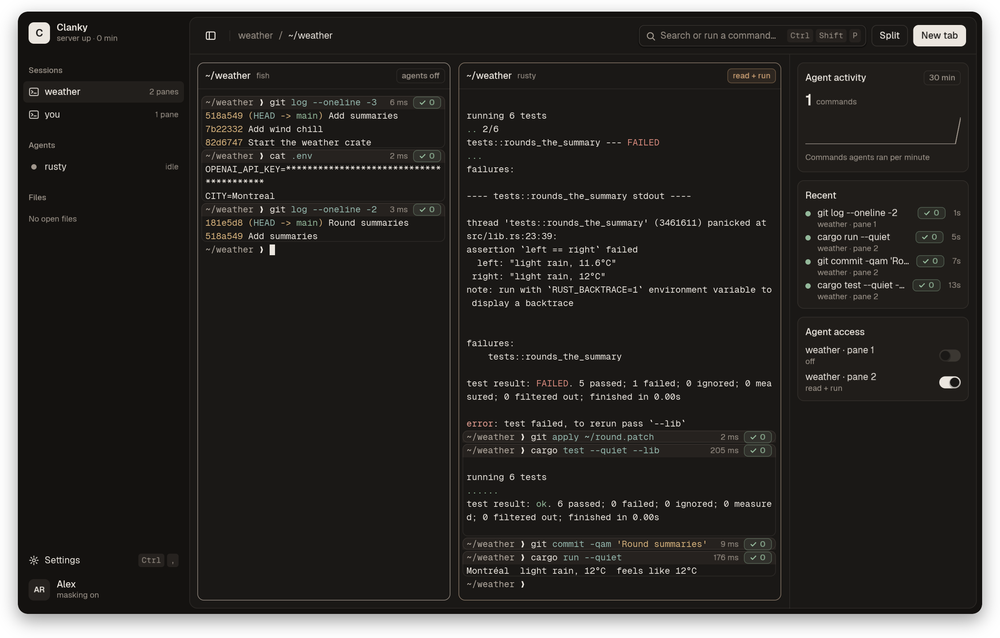
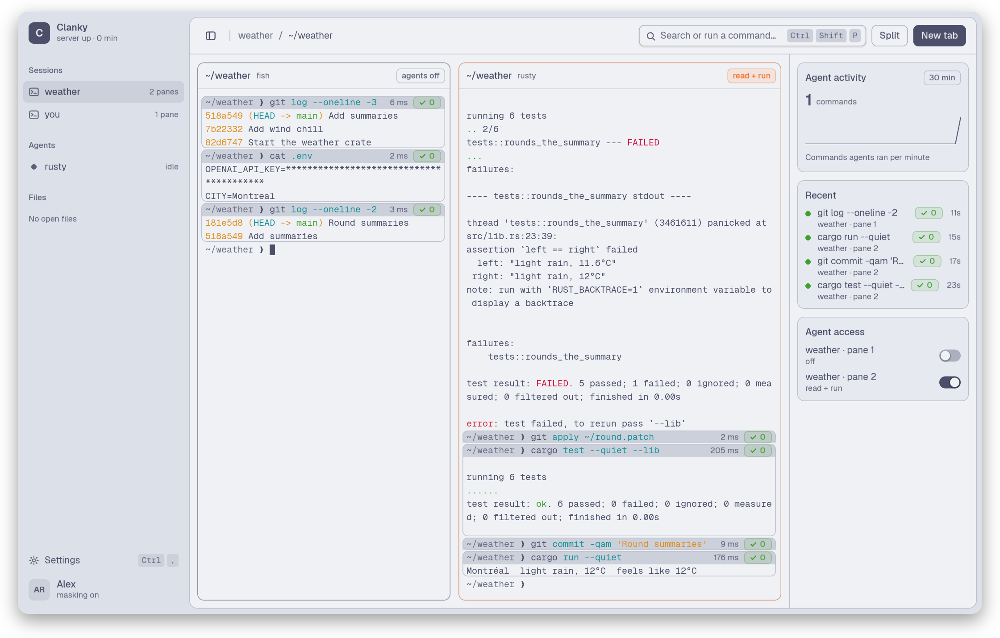
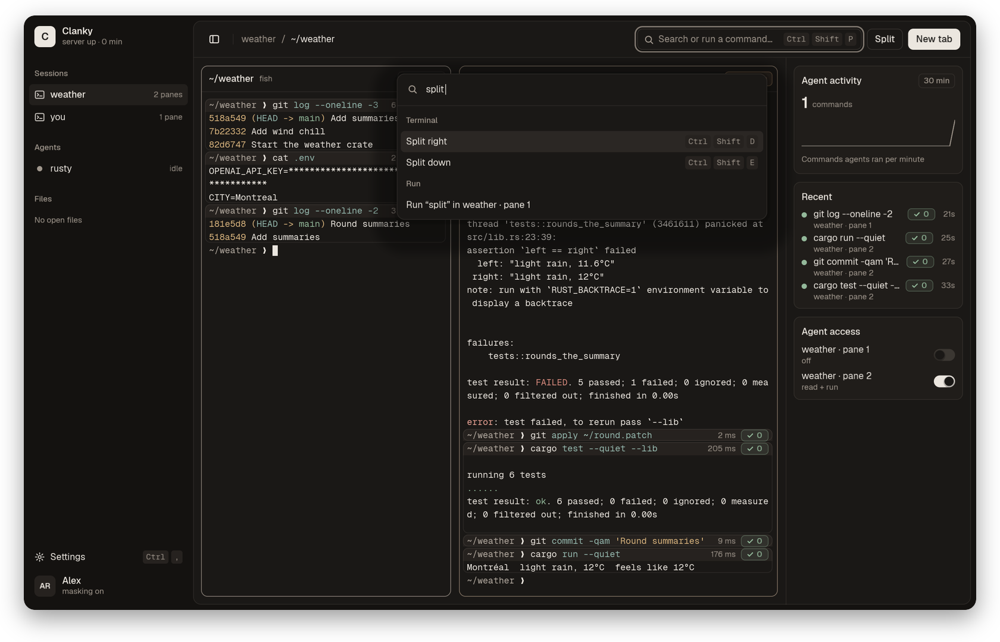
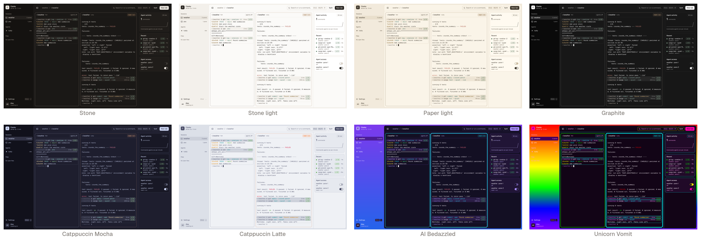
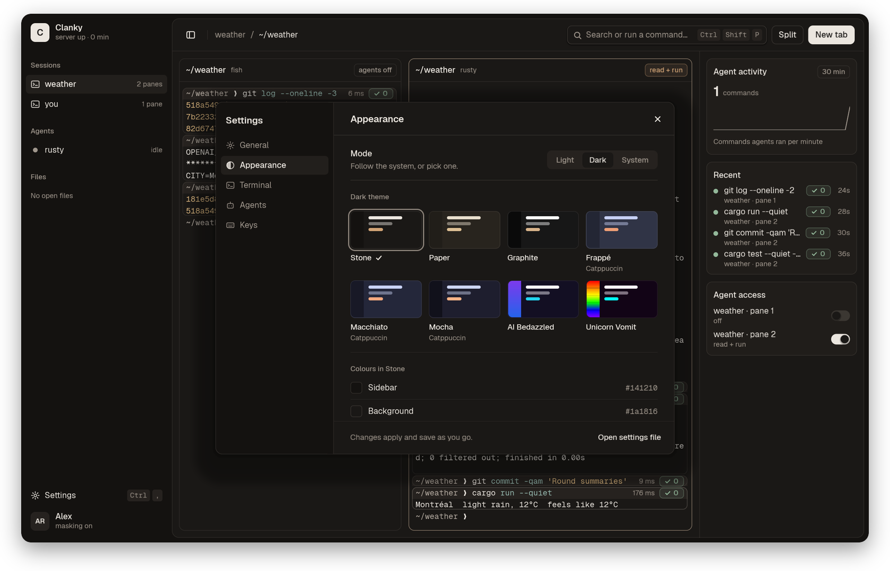

<p align="center">
  
</p>

<h1 align="center">Clanky</h1>

<p align="center">
  <b>A calm, fast Linux terminal for working alongside coding agents.</b><br>
  Agents work in the panes you allow. Your secrets stay hidden. Every command becomes a card.
</p>

<p align="center">
  <a href="https://github.com/rustytensor/clanky/releases/latest"></a>
  
  
  
</p>

<p align="center">
  
</p>

---

## Agents ask first

A coding agent only sees and types in the panes you open to it. Flip the switch next to a pane, or press **Ctrl+Shift+A**.
**Ctrl+Shift+Escape** takes access away from every agent at once, even in the middle of a wait.
The right column shows which agent is connected, what it ran, and which panes it can reach.

Agents connect through a local socket API or `clanky mcp`. The full reference is in [the agent API](docs/agent-api.md).

## Your secrets stay hidden

Look at the left pane above: `cat .env` printed an API key, and Clanky shows it as stars.
Common API keys, tokens and private keys are masked in what agents read, and in copy, search and the clipboard.
Masking recognises known formats; [its exact coverage and limits](docs/agent-api.md#masking-and-its-limits) are documented.

## Every command is a card

Each command you or an agent runs gets a header with its run time and exit code: a green ✓ 0 or a red ✕ 101.
Hover a card to **Copy** it, **Rerun** it, or hand it to an agent.

## Calm by design

Warm greys, the Geist fonts, no text under 12 px, and no glow outside the joke themes. Nothing moves once the window is idle.
An idle Clanky window draws **0 frames**, and a key press is drawn and presented in about **2 ms** on a desktop GPU ([measured](docs/design-m11-idle.md#re-measured-2026-11-09)).

<p align="center">
  
  
</p>

## 14 themes, and your own

Stone, Paper and Graphite in dark and light, **Ink** (near-black, for late nights), the four official Catppuccin flavours, and three for fun: **AI Bedazzled**, **Unicorn Tears** and **Unicorn Vomit**.
Pick one for dark and one for light, and Clanky follows your system. Save, import and export your own themes as JSON.

<p align="center">
  
</p>

<p align="center">
  
</p>

## Everything else

- **Tabs and splits.** Ctrl+Shift+T opens a tab; Ctrl+Shift+D and Ctrl+Shift+E split right and down.
- **Sessions that survive.** A background server keeps your shells running when you close the window. Reopen it to reattach, or attach over SSH with `clanky attach HOST`.
- **A command palette.** Ctrl+Shift+P runs any action, or types a command into the focused pane.
- **Find** with Ctrl+Shift+F searches everything still on screen and in scrollback, including wrapped lines.
- **An editor with change review.** Ctrl+Shift+O opens a file. When an agent proposes changes, you accept or reject each one.
- **Compose** with Ctrl+Shift+Enter: a spell-checked box for long prompts.
- **Post-AI mode.** `clanky --post-ai`, or one switch in Settings, makes Clanky a plain terminal: agents are refused and every agent control disappears. [More](docs/post-ai.md).
- **Saved history.** Every command, who ran it and its masked output are kept in one SQLite file you can search, export and edit: `clanky history`. [More](docs/history.md).
- **Clanky the robot** says hello the first time you start (7 s; any key skips it). `clanky +hello` brings him back. [More](docs/robot.md).

## Install

**Fedora:** download the RPM from the [latest release](https://github.com/rustytensor/clanky/releases/latest), then

```sh
sudo dnf install ./clanky-*.x86_64.rpm
```

**Debian 13 and Ubuntu 26.04:** download the .deb from the [latest release](https://github.com/rustytensor/clanky/releases/latest), then `sudo apt install ./clanky_*_amd64.deb`.

**Arch Linux:** `clanky` in the AUR (coming).

**From source** (Rust and Cargo):

```sh
cargo build --release -p clanky
./target/release/clanky
```

The window needs a graphical display. `clanky edit FILE[:LINE[:COL]]` also works in a plain terminal.
Packaging details are in [Linux packages](docs/release-linux.md).

## Learn more

[Getting started](docs/getting-started.md) ·
[Keyboard shortcuts](docs/shortcuts.md) ·
[Settings](docs/settings.md) ·
[Configuration](docs/config.md) ·
[Themes](docs/themes.md) ·
[Agent API](docs/agent-api.md)

Clanky is built on forks of Alacritty's terminal and parser, wgpu, cosmic-text and winit.

## Why "Clanky"

A clanker is a robot. This is where they work.

## Licence

Clanky is licensed under either [MIT](LICENSE-MIT) or [Apache-2.0](LICENSE-APACHE), at your option.
Dependencies keep their own licences, including MPL-2.0 for spellbook.
The bundled Geist, Geist Mono, JetBrains Mono and Inter fonts are under the SIL Open Font License 1.1.
See [NOTICE](NOTICE) for attributions.
